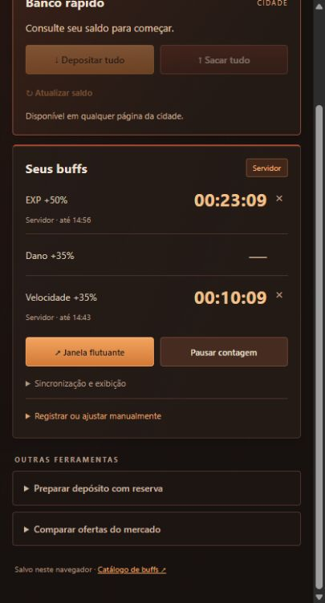

# DeadFrontier Overview

Addon para **Dead Frontier**, com banco rápido, acompanhamento automático de buffs e janela flutuante. Interface em **português e inglês**, com visual inspirado em ferrugem, cobre e vermelho escuro.

**[Baixar ZIP pronto para instalar](https://github.com/raryson/deadfrontier-overview/releases/latest/download/deadfrontier-overview.zip)** · [Guia rápido](INSTALL.md)



## Recursos

- **Banco rápido:** consultar saldo, depositar tudo e sacar tudo pelo painel do inventário, mercado ou outra página da cidade.
- **Buffs automáticos:** acompanha os prazos de EXP, dano e velocidade informados pelo jogo, com relógios separados para efeitos normais e EX.
- **Janela flutuante:** exibe os relógios em Picture-in-Picture enquanto você usa o client.
- **XP no overlay:** XP recebida com bônus, XP/h, XP atual, perdas e ganho líquido da sessão. XP base e base/h estimadas por um multiplicador informado pelo jogador.
- **Ferramentas extras:** preparo de depósito mantendo uma reserva e comparação manual de ofertas por preço unitário.
- **Idiomas:** Automático (navegador), Português ou English. A escolha manual fica salva.

## Instalar no Firefox

Requer **Firefox 140 ou superior**. Esta versão é instalada temporariamente para desenvolvimento e testes.

1. Baixe o [ZIP pronto da versão mais recente](https://github.com/raryson/deadfrontier-overview/releases/latest/download/deadfrontier-overview.zip).
2. Guarde o arquivo. Para o pacote de release, não é necessário extrair no Firefox.
3. Abra o Firefox e digite `about:debugging#/runtime/this-firefox` na barra de endereços.
4. Clique em **Carregar extensão temporária…** / **Load Temporary Add-on…**.
5. Selecione o próprio arquivo **`deadfrontier-overview.zip`**. Se preferir extrair, selecione **`manifest.json`** na pasta extraída.
6. Abra ou recarregue [Dead Frontier](https://fairview.deadfrontier.com/onlinezombiemmo/index.php) e entre normalmente na sua conta pelo jogo.
7. Clique em **◈ DeadFrontier Overview**, no canto inferior direito da página.

**Ao reiniciar o Firefox, a instalação temporária termina.** Repita os passos 3 a 5 para carregá-la novamente. Não apague a pasta extraída enquanto estiver usando a extensão. Instalação permanente na versão comum do Firefox requer um pacote assinado pela Mozilla; este repositório ainda não fornece esse pacote.

Não é necessário executar o instalador do jogo, instalar Node.js ou rodar comandos para usar o addon.

## Instalar no Chrome

Use uma versão atual do Chrome.

1. Baixe o [ZIP pronto](https://github.com/raryson/deadfrontier-overview/releases/latest/download/deadfrontier-overview.zip) e extraia para uma pasta.
2. Abra `chrome://extensions`.
3. Ative **Modo do desenvolvedor** / **Developer mode**.
4. Clique em **Carregar sem compactação** / **Load unpacked**.
5. Selecione a **pasta que contém `manifest.json`**, e não o arquivo individual.
6. Recarregue a página do Dead Frontier e abra **◈ DeadFrontier Overview**.

O Firefox é o navegador usado na validação real do addon. O Chrome possui suporte previsto no código, mas ainda precisa de validação completa.

## Atualizar

1. Baixe o ZIP da versão nova, ou atualize seu clone do repositório.
2. No Firefox, abra `about:debugging#/runtime/this-firefox`. Se instalou pelo ZIP, use **Carregar extensão temporária…** e selecione o **ZIP novo**. Se usa uma pasta ou clone, atualize **todos** os arquivos nessa mesma pasta, incluindo `manifest.json`, e clique **Recarregar** no cartão da extensão. Apenas atualizar a página do jogo não recarrega o manifesto.
3. No Chrome, abra `chrome://extensions` e clique no botão de recarregar da extensão.
4. Recarregue as abas do jogo. Feche a janela flutuante antiga e abra outra pelo painel atualizado.

Feche as abas antigas do addon e abra uma nova pelo ícone da extensão. Desde 0.7.2, o número no topo mostra a versão do manifesto realmente carregado pelo navegador. Se o OCR indicar manifesto antigo ou WebAssembly bloqueado, carregue o pacote atualizado seguindo os passos acima. O identificador interno permanece estável entre versões para preservar os dados locais; instalações temporárias não devem ser usadas como backup.

## Como usar

### Banco rápido

Abra o painel em qualquer página da cidade. **Atualizar saldo** consulta bolso e banco sem movimentar dinheiro. **Depositar tudo** e **Sacar tudo** executam uma operação por clique e exibem os saldos retornados pelo servidor.

A inicialização do banco é carregada em segundo plano; sua tela atual permanece aberta. Se aparecer uma resposta não confirmada, consulte os saldos antes de repetir a operação. O addon não repete movimentações automaticamente.

Os botões de movimentação funcionam no painel dentro do jogo. Na aba independente da extensão, ficam desativados.

### Buffs

Recarregue a página da cidade depois da instalação. O selo **Servidor** indica que os prazos foram recebidos do jogo. O uso de um consumível no navegador atualiza os relógios quando a resposta inclui seus novos prazos.

O registro manual fica em **Registrar ou ajustar manualmente** e serve como alternativa. Uma nova sincronização substitui os tempos manuais dos efeitos presentes na resposta. Pausar afeta apenas o acompanhamento local; uma nova sincronização retoma a contagem em tempo real.

Os relógios continuam contando durante o fechamento da aba ou do jogo. As notificações dependem de o navegador estar funcionando e das permissões do sistema.

### Janela flutuante

1. Clique no ícone da extensão na barra do navegador para abrir o painel em uma aba independente.
2. Clique em **Janela flutuante**.
3. No Firefox, um vídeo local dos relógios aparece no painel. Clique com o botão direito nele e escolha **Picture-in-Picture**. No Chrome, o botão usa a API de PiP quando disponível.
4. Mantenha essa aba aberta. Use o client em modo janela ou sem bordas: tela cheia exclusiva pode cobrir a janela.

O vídeo do overlay é gerado localmente com os relógios e as métricas. A captura da janela do jogo para ler XP é uma função separada, iniciada pelo botão **Conectar janela do client**.

### Idioma

O seletor **Idioma / Language** fica no topo. **Automático** segue a ordem de preferência do navegador entre português e inglês; se nenhum deles estiver disponível, usa inglês. Uma escolha manual prevalece até você selecionar Automático novamente.

Nomes oficiais dos itens permanecem como no jogo para facilitar sua identificação.

### XP da sessão e XP por hora

1. Abra uma página da cidade para identificar o personagem. Abra o painel em uma **aba independente**, pelo ícone da extensão.
2. Com o client aberto, clique **Conectar janela do client** e selecione a janela do jogo no seletor de compartilhamento do navegador.
3. Confira a leitura na prévia. Se necessário, arraste um retângulo em volta da linha **LV + XP atual / XP necessária**, no canto superior esquerdo. Alterar o recorte zera a sessão para evitar comparar áreas diferentes.
4. Espere a leitura estabilizar e confira se os números correspondem ao HUD. Clique **Iniciar sessão**: a XP anterior não entra nos ganhos.
5. Para estimar XP sem bônus, abra **Configurar estimativa sem bônus** e informe o **multiplicador efetivo de XP**. Um bônus efetivo total de +100% equivale a 2×. Inclua alimentação, profissão, eventos e equipamentos no fator.
6. Abra a janela flutuante para ver XP recebida, XP/h e estimativas sem bônus. Ao mudar de bônus, ajuste o multiplicador; o novo fator vale para os próximos intervalos. Intervalos sem fator ficam marcados como estimativa parcial.

**A XP base é uma estimativa, não um valor separado lido do servidor.** A XP recebida vem de diferenças nas leituras de XP do personagem e pode incluir várias fontes, não apenas combate. Perdas e ganho líquido ficam separados. Mudanças de nível são tratadas pela tabela de XP quando disponível; lacunas são indicadas em vez de gerar ganhos inventados.

A XP ao vivo vem de **OCR local da janela do client**, com leituras a cada aproximadamente 2 segundos. Consultar a cidade fornece somente XP salva e não acompanha o combate em tempo real. Quando o HUD mostra `K`, a precisão é de aproximadamente 1.000 XP; valores e taxas são aproximados. Leituras instáveis ou antigas são sinalizadas. A janela precisa continuar renderizando o HUD; minimizá-la pode interromper a atualização. Em outras resoluções, escala do Windows ou modo janela, ajuste o recorte.

Mantenha a aba de captura aberta. **Parar** congela a sessão, mas mantém a leitura disponível. **Parar captura**, fechar a aba ou interromper o compartilhamento encerra a captura e a medição. **Zerar sessão** descarta os totais. O navegador solicita uma nova seleção da janela a cada conexão.

## Privacidade

- Sem serviço externo, analytics ou envio de dados ao GitHub durante o uso.
- OCR, modelo de idioma e WebAssembly vêm no pacote. Frames são processados em memória neste computador, sem gravação, upload ou captura de áudio. Apenas valores numéricos de XP e coordenadas do recorte ficam salvos localmente.
- Relógios, idioma, identificador do personagem mais recente e cotações ficam no armazenamento local da extensão.
- O observador encaminha uma lista explícita de campos de buffs, sem salvar cookies, senhas, tokens ou corpos completos de requisição/resposta.
- O banco rápido reutiliza a autenticação já disponível no jogo **somente no contexto da página**, para o endpoint do próprio jogo. Esses dados não são encaminhados ao painel nem gravados no armazenamento da extensão.
- As imagens publicadas neste repositório usam dados fictícios. Capturas de contas reais, arquivos de sessão, `.env`, HARs e arquivos temporários ficam fora do Git.

Ao reportar um problema, envie a versão do addon, navegador e texto da mensagem de erro. Não envie senhas, cookies, tokens, HARs ou requisições completas.

## Limites

Buffs e banco acompanham a cidade no navegador; os buffs dependem dos dados enviados pela cidade. A XP pode acompanhar o client por captura visual autorizada pelo usuário. O addon não lê memória do executável nem injeta DLL. Bônus fora dos canais normais/EX de EXP, dano e velocidade não são inferidos pelos percentuais. A versão atual mantém os relógios do personagem mais recente.

O addon não possui aprovação oficial dos administradores. Consulte as regras atuais do jogo antes de usar modificações de interface.

## Desenvolvimento

Requer Node.js com suporte a `node --test`. As dependências de desenvolvimento servem para reproduzir os arquivos de OCR já incluídos no pacote.

```sh
git clone https://github.com/raryson/deadfrontier-overview.git
cd deadfrontier-overview
npm ci --ignore-scripts
npm run vendor:ocr
npm test
npm run check
```

Para gerar o ZIP com uma lista explícita de arquivos, execute `./scripts/package.ps1` no PowerShell. O resultado fica em `dist/`, que é ignorado pelo Git. Tags `vX.Y.Z` com a mesma versão do manifesto acionam testes e publicam o ZIP e seu SHA-256 em GitHub Releases. O pacote não contém capturas, testes, perfis ou arquivos temporários.

Os testes cobrem timers, sincronização, EX, idioma, notificações, serialização bancária, sessão, erros e prevenção de repetição automática. Testes simulados não substituem a validação no servidor real. Detalhes em [docs/integration.md](docs/integration.md).

Fontes do catálogo: [Drugs](https://deadfrontier.fandom.com/wiki/Drugs), [Food](https://deadfrontier.fandom.com/wiki/Food) e [Medication & Repair Kits](https://deadfrontier.fandom.com/wiki/Medication_%26_Repair_Kits). Confira o tooltip do jogo caso haja divergência com a wiki.

## English: installation

**Firefox 140+:** download the [ready-to-install ZIP](https://github.com/raryson/deadfrontier-overview/releases/latest/download/deadfrontier-overview.zip), open `about:debugging#/runtime/this-firefox`, click **Load Temporary Add-on…**, and select the ZIP directly (or `manifest.json` if extracted). Reload Dead Frontier and click **◈ DeadFrontier Overview** at the bottom right. Temporary installations end when Firefox restarts; load the ZIP again. A permanent installation requires Mozilla signing.

**Chrome:** extract the ZIP, open `chrome://extensions`, enable **Developer mode**, click **Load unpacked**, and choose the folder containing `manifest.json`. Reload the game page. Firefox is the browser used for live validation; full Chrome validation is still pending.

Use the **Language** selector at the top for English, Portuguese, or automatic browser language detection. Keep the extension tab open when using the floating timer window. Never share credentials, cookies, HAR files, or full request payloads in an issue.

**Live XP:** open the city once to identify your character, then open the extension in its own tab. Click **Connect client window**, select the game window, and verify the OCR preview. Drag a rectangle around the LV/XP line if needed. Wait for a stable reading, then start the session. Keep this tab open. OCR runs locally with bundled assets; frames are never uploaded or recorded and audio is disabled. HUD values shown in K have roughly 1,000 XP precision. Base XP is estimated from your effective multiplier. Stop capture to release the shared window.
